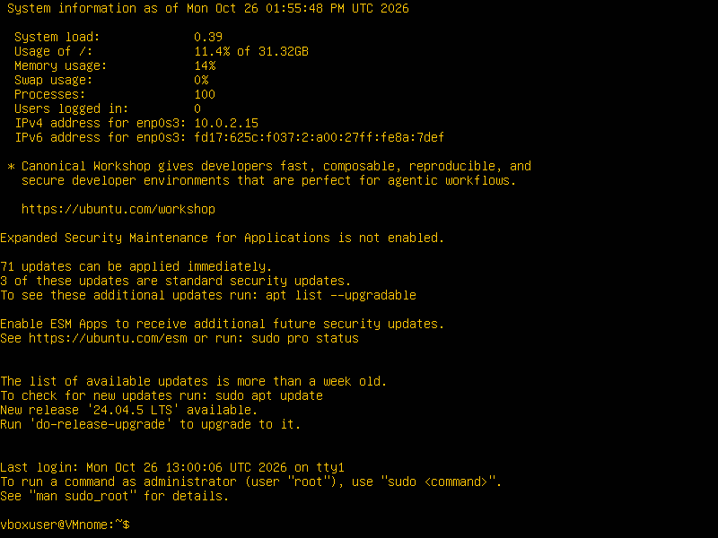
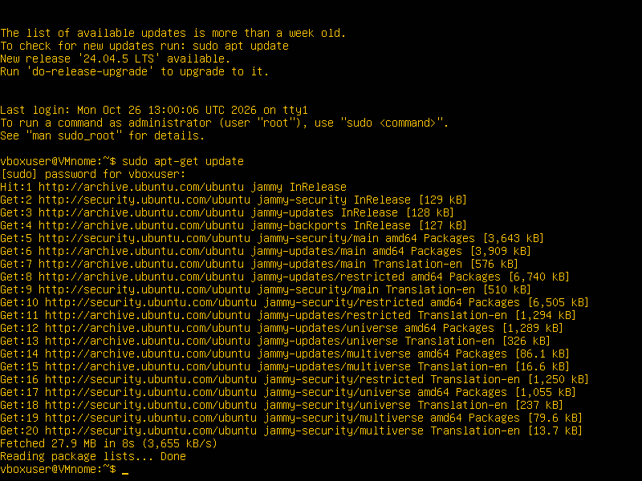

Aula 01 - Introdução à Virtualização e Instalação do Ubuntu Server 26.04

Relatorio:
1) Charlie Ethan dos Santos Ugá Luna, 2024327037, 913-A, 28/10/2026
2) Nessa atividade foi realizado a a preparação, baixando a ISO ubunto, depois foi feita a criação da maquina virtual no virtualbox e configurção da propria antes do boot e depois do boot, além da configuração de usuario
3) RAM: 1.5 GB, HardDisk: 32 GB, 1 processador. NAT, IP: 127.0.0.1/8
4) login: vboxuser, senha: *******, sudo apt-get update
5)  A. 

    B. 

    C. 
6) sem problemas relatados
7) Foi aprendido como criar virtualbox com uma ISO e configurar a VM

Tarefas de Pós-Instalação
Após o reinício completo da máquina virtual:

    1.Realize o login no console tty1 com as credenciais criadas:
        Login: administrador
        Senha: adminifal

    2.Execute o comando de atualização da lista de pacotes para garantir a comunicação correta com os espelhos oficiais:
        sudo apt-get update

    3.Digite a senha adminifal quando solicitado pelo sudo.

Charlie Ethan 913-A