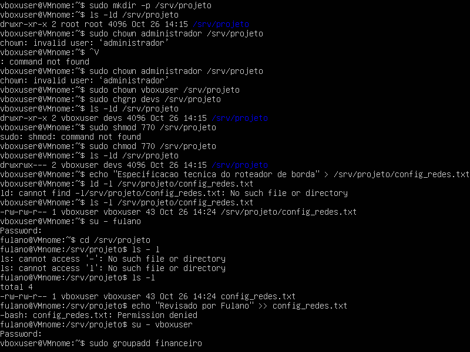
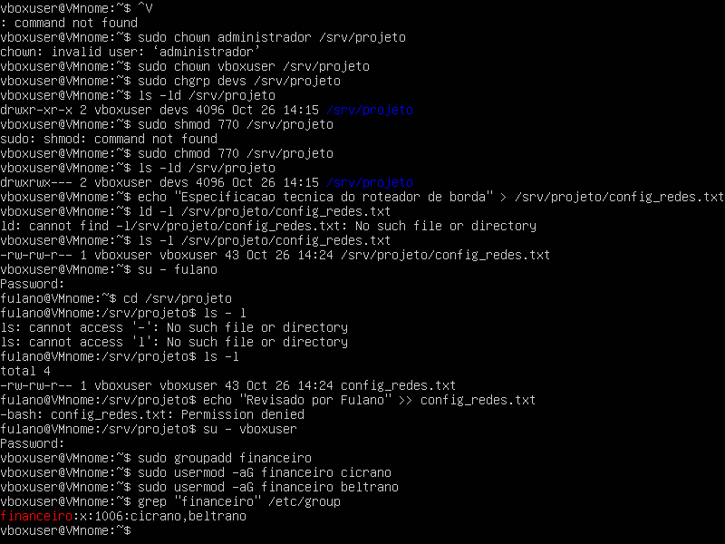
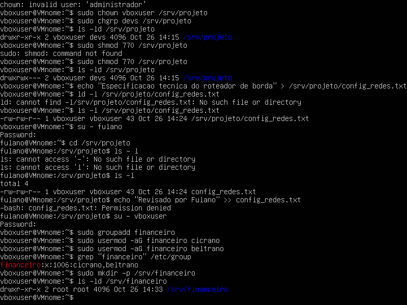
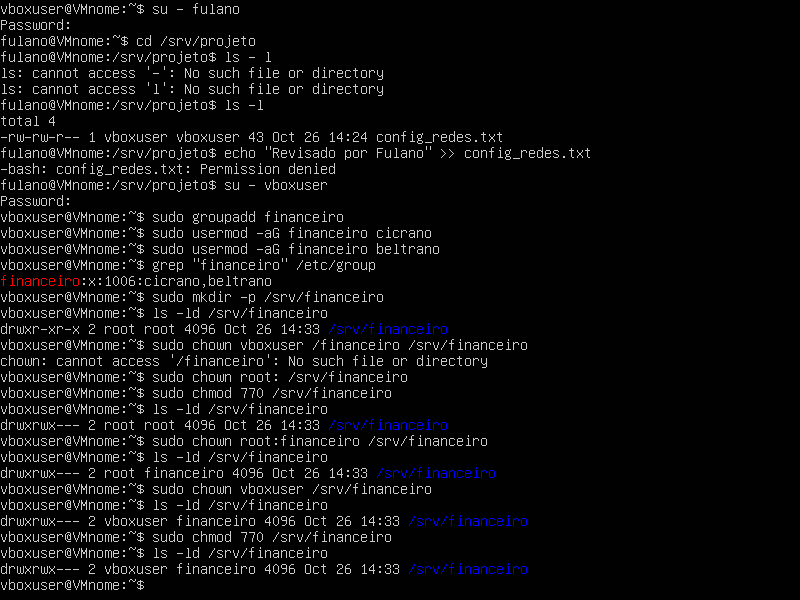
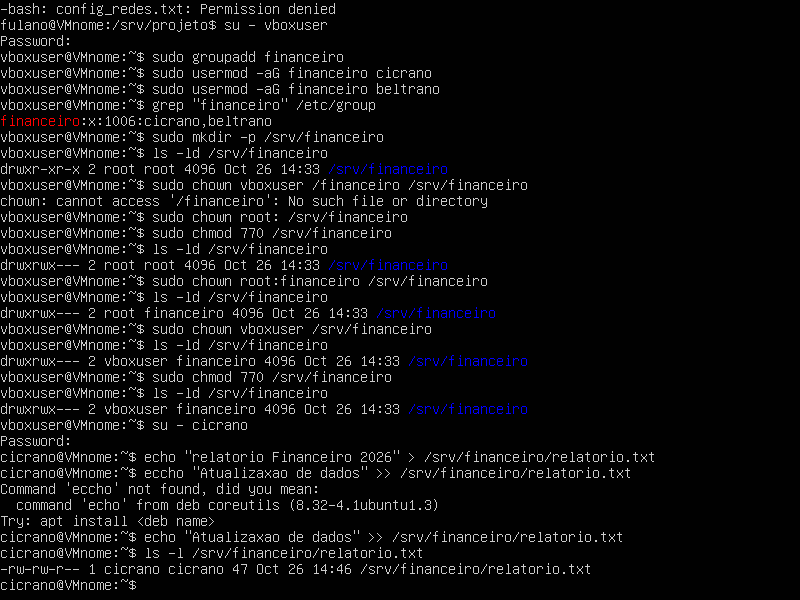
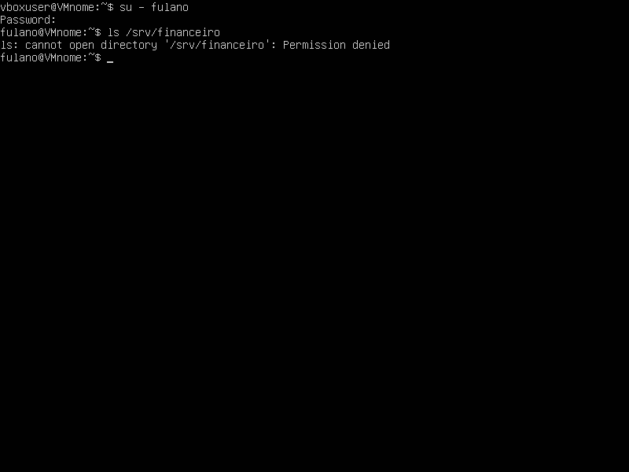
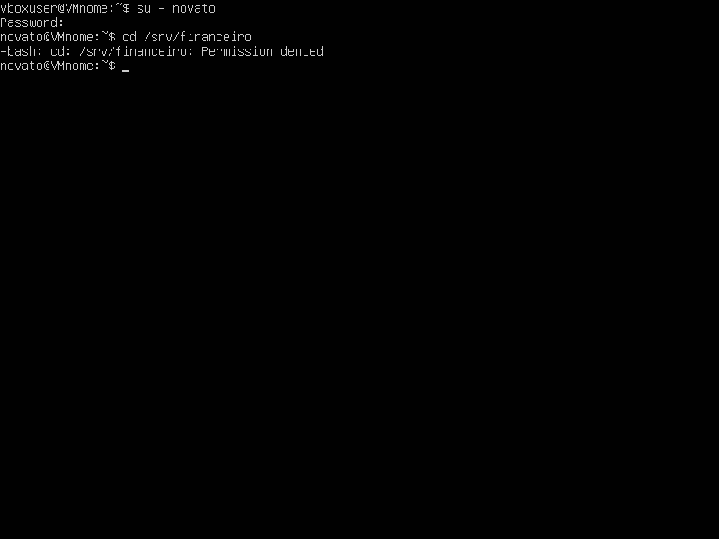

Aula 02: Administração de Usuários, Grupos e Permissões no Linux

1) Charlie Ethan dos Santos Ugá Luna, 2024327037, 913-A, 29/10/2026
2) nessa aula fizemos a adiministração de usuarios, grupos e permissões de acesso de arquivos e diretorios.
3) RAM: 1.5 GB, HardDisk: 32 GB, 1 processador. NAT, IP: 127.0.0.1/8
Exercício Prático de Fixação
4)  sudo groupadd financeiro,
    sudo usermod -aG financeiro cicrano,
    sudo usermod -aG financeiro beltrano, 
    grep "financeiro" /etc/group, 
    sudo mkdir -p /srv/financeiro, 
    ls -ld /srv/financeiro, 
    sudo chown vboxuser /srv/financeiro, 
    sudo chmod 770 /srv/financeiro, 
    su - cicrano, echo "relatório Financeiro 2026", 
    echo "atualizaxao de dados" >> /srv/financeiro/relatório.txt
    ls -l /srv/financeiro/relatório.txt,
    su - fulano,
    su - novato

5)  A. 

    B. 

    C. 

    D. 

    E. 
        a. 
        b. 
        c. 

6) problema ao configurar as permissões de usuarios, resolvido pesquisando qual comando usar
7) foi aprendido como fazer diferentes usuarios dentro da maquina virtual, assim como criar grupos, pastas e arquivos, também como e quais permissões dar a cada usuario.

Para consolidar as competências adquiridas, cada aluno ou grupo deverá executar de forma autônoma a seguinte tarefa:

    1.Criar um novo grupo chamado financeiro.
    2.Associar os usuários cicrano e beltrano ao grupo financeiro (além do grupo devs ao qual já pertencem).
    3.Criar uma nova pasta compartilhada em /srv/financeiro.
    4.Definir as seguintes permissões de acesso:
        *O usuário administrador deve ter controle total.
        *O grupo financeiro deve ter acesso de leitura e escrita.
        *Os membros do grupo devs (como fulano) e o usuário novato não devem ter acesso a esta pasta financeira.
    5.Demonstrar em testes de terminal que cicrano consegue criar e alterar um relatório na pasta, enquanto fulano e novato recebem a mensagem Permission denied.

Respostas:
