Relatório (Modelo de 7 Passos)

Crie um README.md em seu repositório pessoal no GitHub com:

    1.Identificação: nome completo, matrícula, turma, data e título da prática.
    2.Objetivo: o que foi realizado.
    3.Ambiente: especificações da VM, modo de rede e endereços IP.
    4.Procedimento: comandos executados, em ordem.
    5.Testes: capturas de tela de ip addr, ip route e dos testes de ping; tabela comparativa NAT x Bridge (IP, gateway, host acessa a VM).
    6.Problemas e Soluções: ao menos um problema encontrado e como foi resolvido.
    7.Conclusão: o que foi validado e aprendido.

Critérios de Avaliação

    *Identificou corretamente IP, máscara, gateway e MAC.
    *Explicou por que o host não alcança 10.0.2.15 no modo NAT.
    *Executou os testes de ping em camadas e diagnosticou a camada de uma *falha.
    *Comparou NAT e Bridge com evidências.
    *Documentou no formato de 7 passos.

1. 
    a. 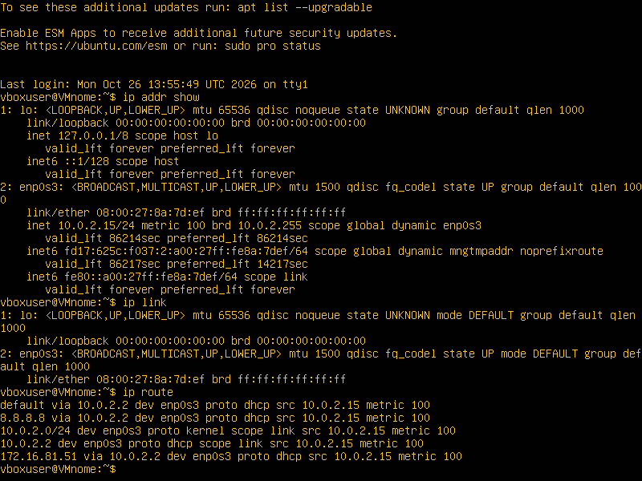
    b. 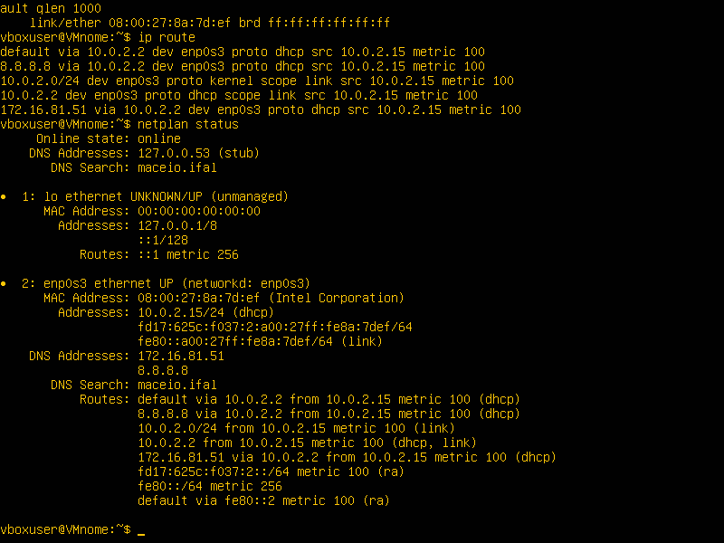

    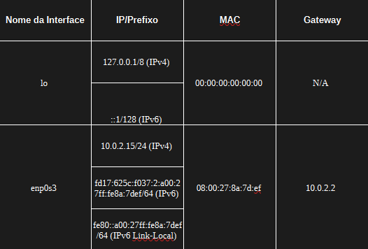

2. 
    a. 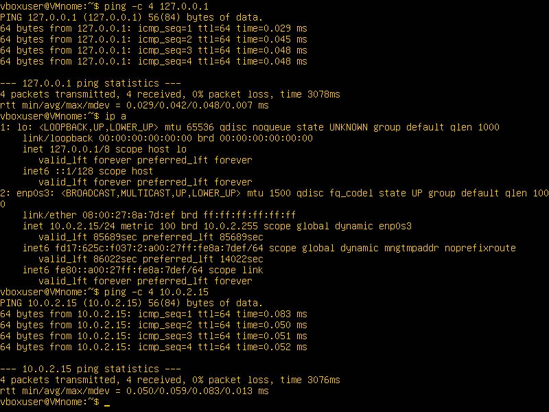
    b. 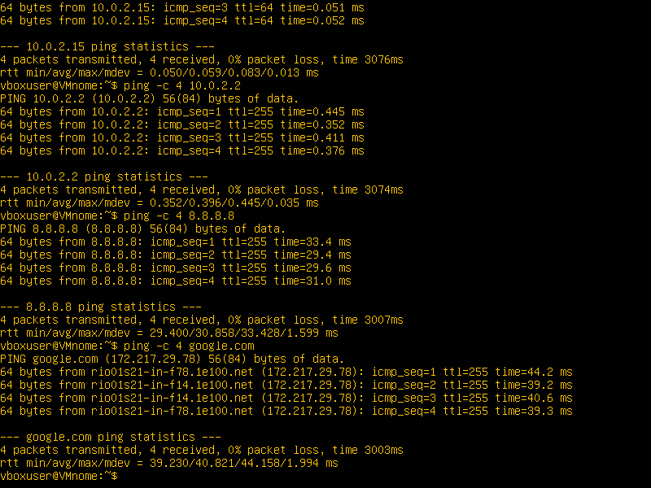

3. 
    a. 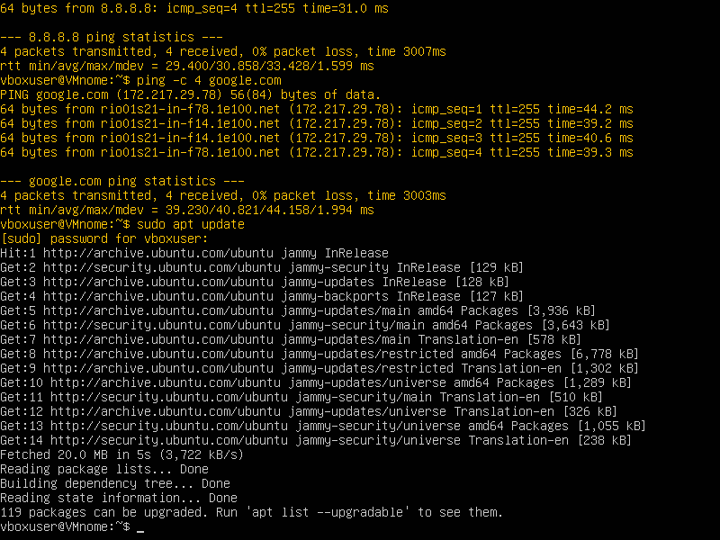
    b. 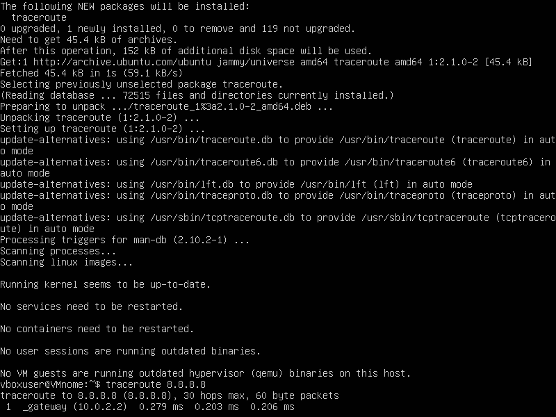
    c. 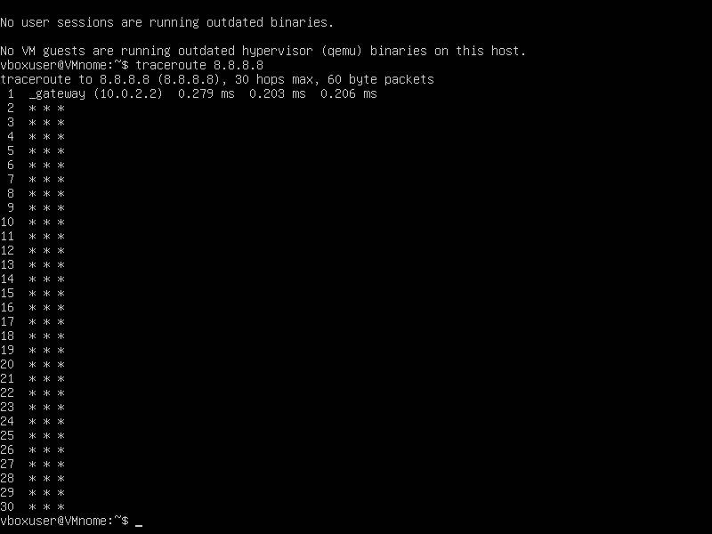

4. 
    a. 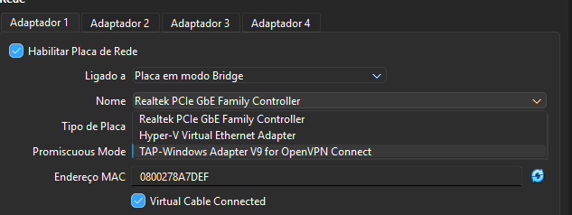
    b. 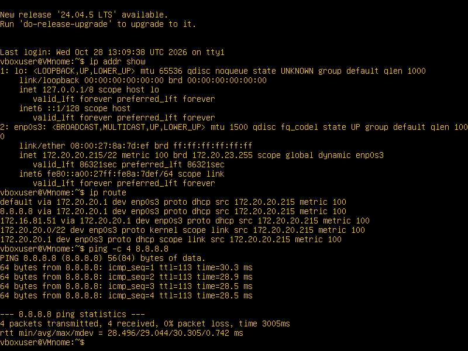

    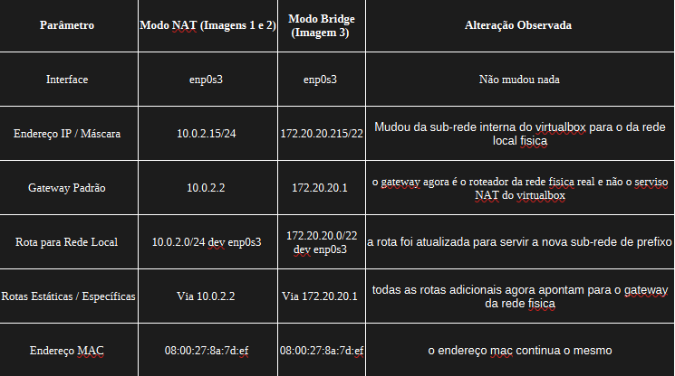

5. 
    a. 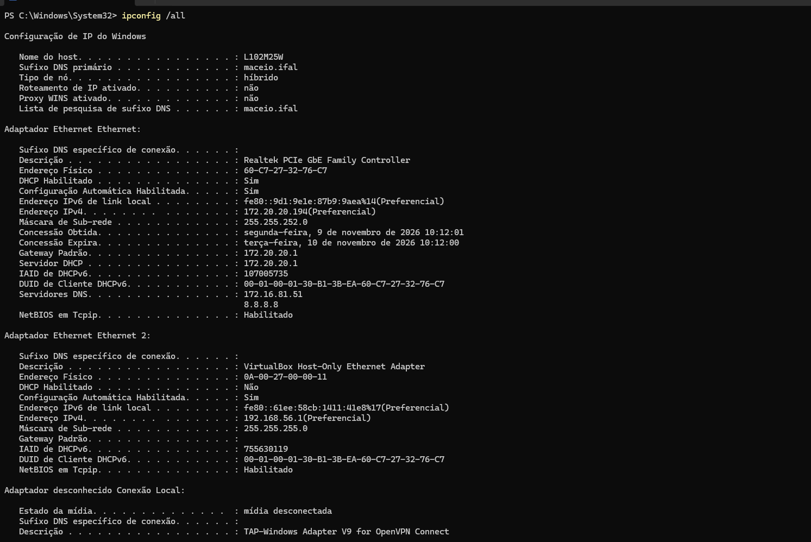
    b. 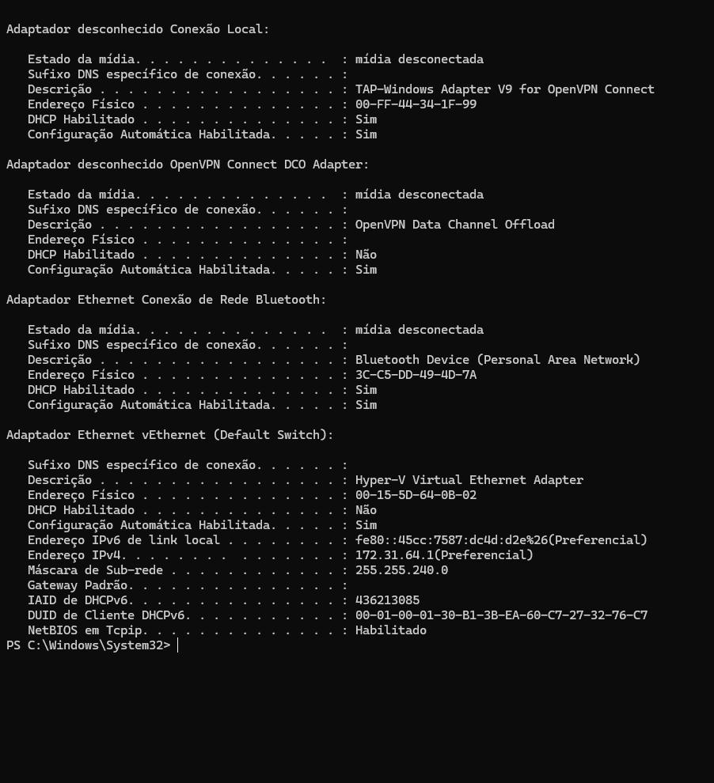