Aula 03: Interfaces e Endereçamento de Rede

Relatorio:
1) Charlie Ethan dos Santos Ugá Luna, 2024327037, 913-A, 09/11/2026
2) conseguir ver e identificar IP, mascara de sub-rede, MAC, gateway e DNS, usando dos principais comandos para identificar IP, Link e route, diferenciar o nat e Bridge, testar a conectividade com o ping e fazer a doocumentação.
3) RAM: 1.5 GB, HardDisk: 32 GB, 1 processador. NAT e PLaca de Ponte, IP: 127.0.0.1/8
4) 
5)  A. 
        a. 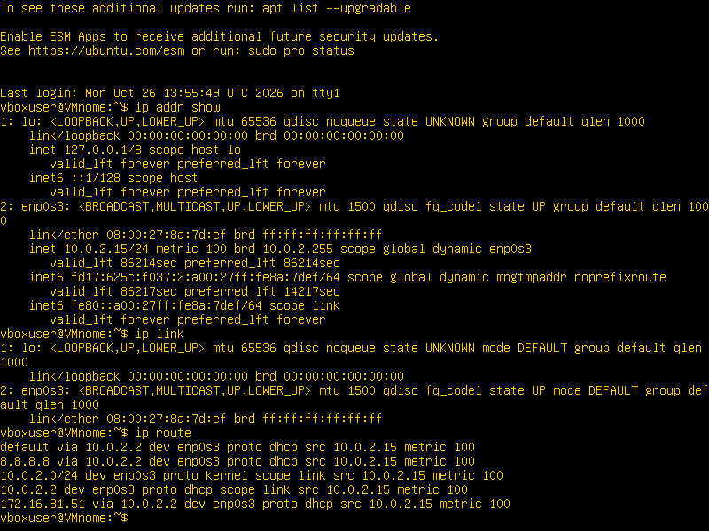
        b. 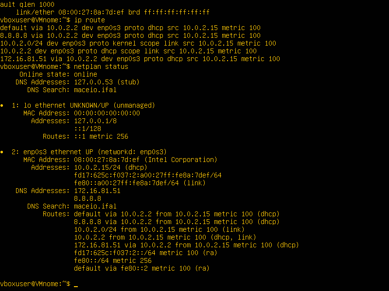
        c. 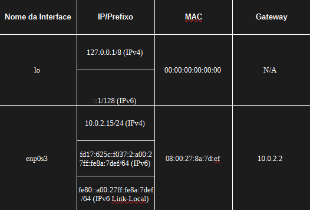

    B. 
        a. 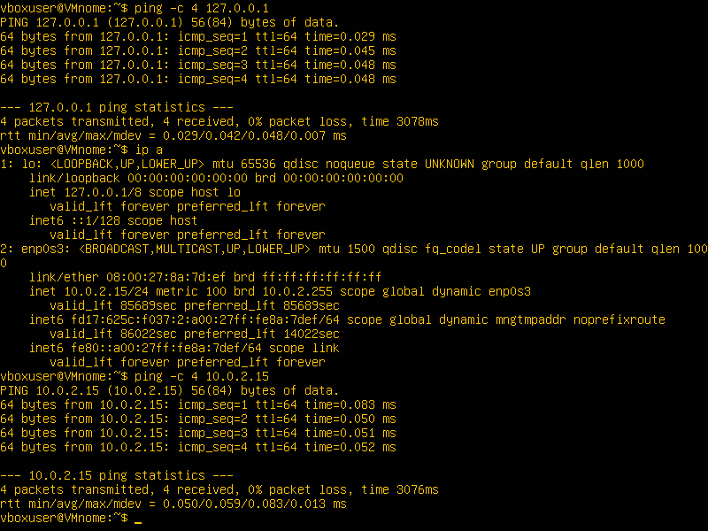
        b. 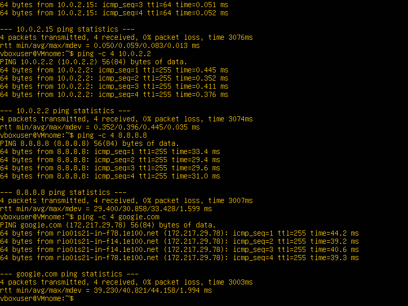

    C. 
        a. 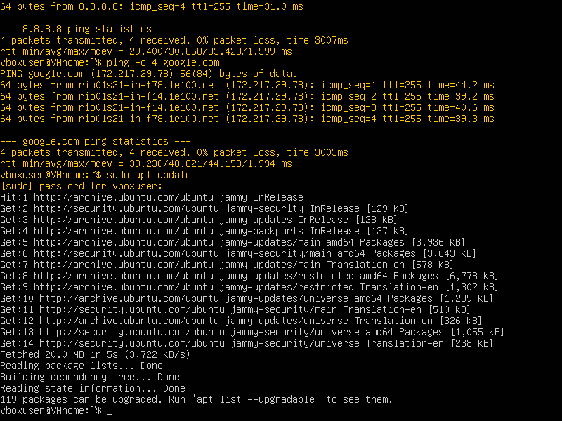
        b. 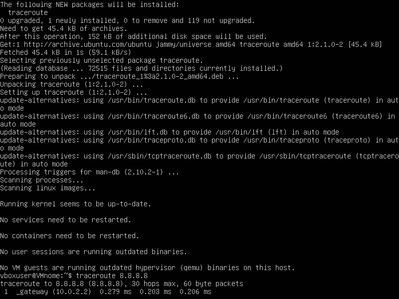
        c. 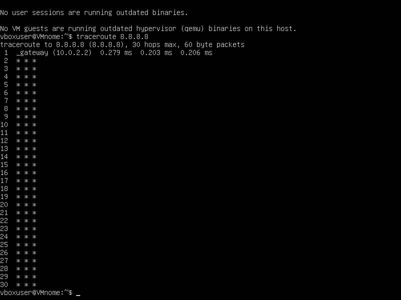

    D. 
        a. 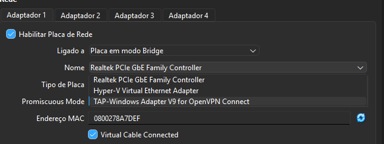
        b. 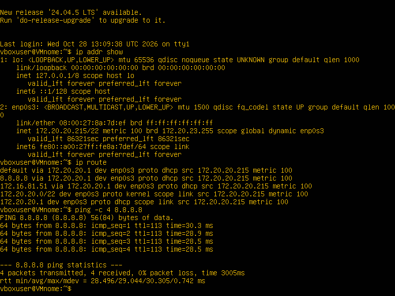
        c. 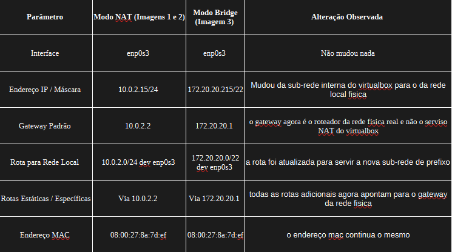

    E. 
        a. 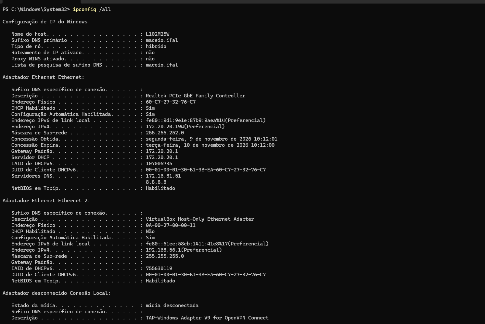
        b. 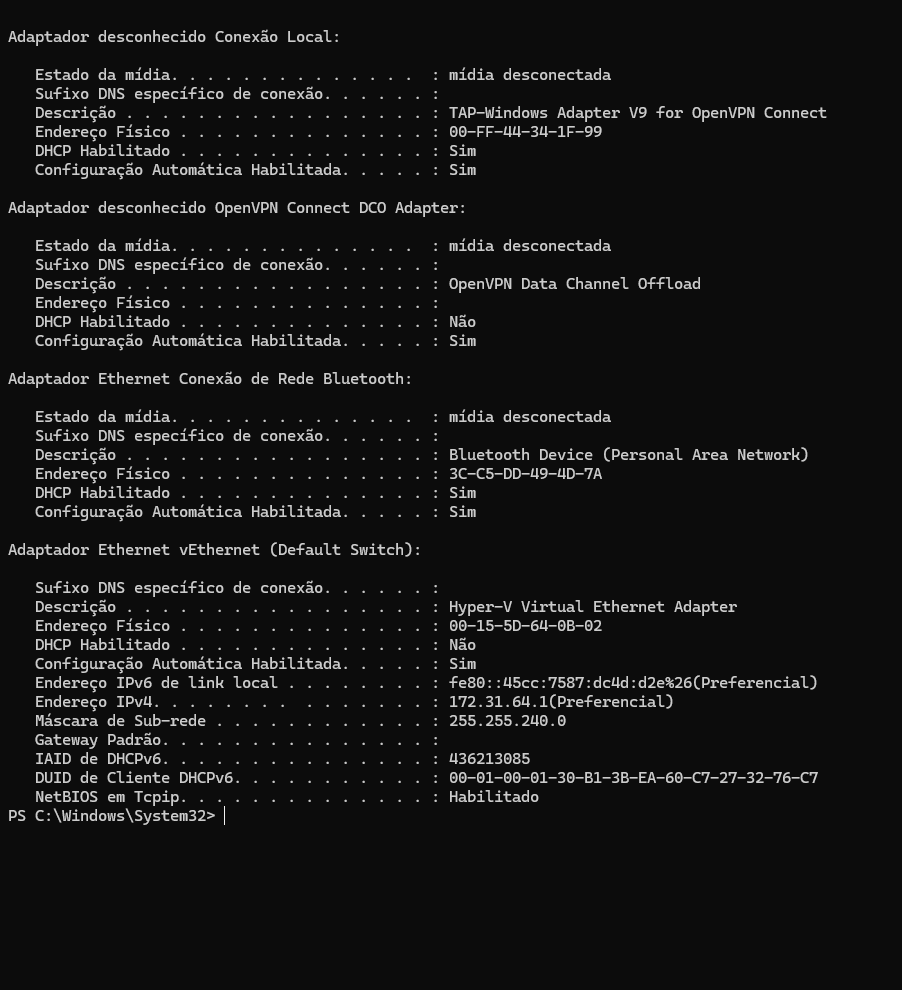
6) 
7) 

Relatório (Modelo de 7 Passos)

Crie um README.md em seu repositório pessoal no GitHub com:

    1.Identificação: nome completo, matrícula, turma, data e título da prática.
    2.Objetivo: o que foi realizado.
    3.Ambiente: especificações da VM, modo de rede e endereços IP.
    4.Procedimento: comandos executados, em ordem.
    5.Testes: capturas de tela de ip addr, ip route e dos testes de ping; tabela comparativa NAT x Bridge (IP, gateway, host acessa a VM).
    6.Problemas e Soluções: ao menos um problema encontrado e como foi resolvido.
    7.Conclusão: o que foi validado e aprendido.

Critérios de Avaliação

    *Identificou corretamente IP, máscara, gateway e MAC.
    *Explicou por que o host não alcança 10.0.2.15 no modo NAT.
    *Executou os testes de ping em camadas e diagnosticou a camada de uma *falha.
    *Comparou NAT e Bridge com evidências.
    *Documentou no formato de 7 passos.

